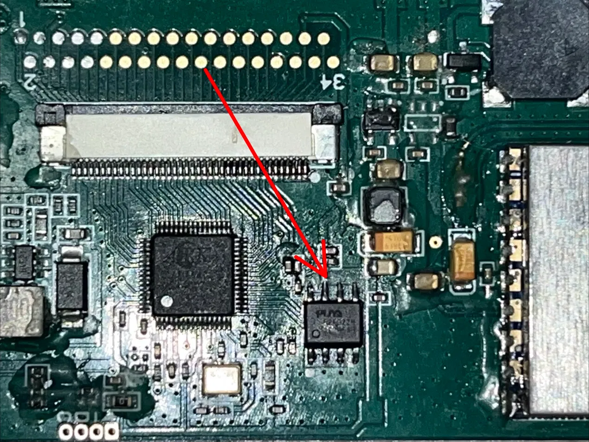

# VR03 Mod v1.0 – battery voltage overlay, settings menu for BETAFPV VR03 goggles

> **Version 1.0 – still in the testing stage.** All functions have been tested on real hardware (see [Status](#status)),
> but other goggles may behave differently.
> Found a problem? Please open an **[issue](../../issues)**.

A small community modification for the **BETAFPV VR03** analog FPV goggles. It is applied as a *patch* to a dump of
**your own** goggles' firmware – this repository does **not** contain any BETAFPV or ARK Micro firmware.

> *This project was made with the help of Claude (Anthropic's AI assistant): the firmware analysis, the added code, the
> tooling and this documentation were developed in a conversation between the author and Claude, and tested by the author
> on real goggles.*

## Disclaimer

* **Unofficial and unaffiliated.** This project is not affiliated with, endorsed by or supported by BETAFPV, ARK Micro or
  any of their partners. *BETAFPV* and *VR03* are trademarks of their respective owners and are used here only to say which
  hardware the mod is meant for.
* **No vendor firmware is distributed.** The repository contains one Python script with a small patch (only the bytes that
  differ from the stock image, mostly new code placed in an unused area of the flash) and documentation. You must dump
  the flash of your own goggles yourself. Please do not upload or share dumps of the stock firmware in issues or pull requests.
* **Use at your own risk.** Flashing a chip can permanently damage ("brick") the goggles and will void any warranty. You are
  solely responsible for your device. The author takes no responsibility for any damage. Keep a backup of your original
  firmware in more than one place.
* The information below was obtained by analysing the author's own device for interoperability and personal modification.
  It is provided for educational purposes and is not legal advice.

## What the mod adds (v1.0)

| Feature | Description |
|---------|-------------|
| **Battery voltage on the OSD, always visible** | Shows e.g. `3.79V` on top of the analog picture at all times. It is drawn in its own OSD window, so the received video is never interrupted. |
| **Colour by charge** | **Green** at 3.80 V and above, **yellow** from 3.55 V to 3.79 V, **red** below 3.55 V. |
| **Position selection** | Bottom-left (`BL`, default), top-left (`TL`), bottom-centre (`BC`), bottom-right (`BR`). Top-centre and top-right are intentionally not offered because the stock channel label lives there and overlaps. |
| **`MOD SETTINGS` menu** | A new page in the style of the Brightness / Contrast / Saturation menu (see below). |
| **Beep setting** | The low-battery beep (battery below 3.40 V) can be switched off. When on, it beeps **once** per check and the check interval is tripled, so it is much less annoying than the stock double beep. |
| **Voltage on/off setting** | Hide the overlay completely if you do not want it. |
| **Settings are saved** | The three options are stored in flash together with the stock settings and survive power-off. |

### How to use the MOD SETTINGS menu

Open the menu by **long-pressing the button that is farthest from your face** until **MOD SETTINGS** appears:

```
  MOD SETTINGS
>>Beep alert  ON
  Volt show   ON
  Volt pos    BL
  Back
```

* Next-row key: move down. Left / right keys: change the value. Centre key on a value: change it, on `Back`: return.
* Every change is saved immediately.
* `Back` returns to the normal picture menu.

### Not changed

* The stock firmware has **no** low-voltage power-off – it only beeps. Any automatic shut-down at low voltage is done by
  hardware (battery protection / regulators), so this mod cannot change it.
* The DVR start-up delay (see below) is not affected.

## Status

Version 1.0, **testing stage**.

| Function | Tested on real goggles |
|----------|------------------------|
| Voltage overlay, all 4 positions | Yes |
| Colours | Yes |
| MOD SETTINGS menu, saving of settings | Yes |
| Channel switching, picture menu unaffected | Yes |
| Low-battery beep setting | Yes |

Only **one stock firmware build** is supported (build stamp `Dec 08 2023 16:41:31`, see below). Other versions or hardware
revisions use different addresses and the script will refuse to patch them.

**Please report problems in [Issues](../../issues)** and include: your firmware build stamp, which feature misbehaves, what
you did, and a photo of the screen if it is a display problem. Do **not** attach firmware dumps.

## What you need

* A **CH341A USB programmer** with a **3.3 V** adapter (many cheap CH341A boards output 5 V on the data lines, which can
  destroy the flash chip – check with a multimeter or use a level-shifter / 3.3 V-modified board).
* A **SOIC-8 / SOP8 test clip** *or* a **hot-air station / soldering iron and flux** (see "Desolder the chip" below).
* Programming software: **NeoProgrammer** (Windows) or `flashrom` / `ch341eeprom` (Linux).
* **Python 3** on your computer (python.org installer; on Windows run `py vr03_mod.py` – the Microsoft-Store `python3` alias
  may be blocked).
* A small Phillips screwdriver / spudger to open the goggles, and an anti-static work habit.
* Never program with the battery or USB connected to the goggles.

## Where is the chip?

The firmware lives on a small **8-pin SPI NOR flash chip** marked **`P25Q20H`** (Puya, 2 Mbit = 256 KiB). It looks like the
chip on a PC motherboard's **BIOS**: a small black 8-pin chip with the marking printed on top. On the VR03 mainboard it sits
**right next to the connector of the display ribbon cable (flex cable)**, to the right of the large square main chip
(the ARK Micro AMT630A SoC).



* The red arrow in the photo points at the flash chip.
* Pin 1 is marked by a round dot on the chip body (bottom-left corner in the photo). Align the programmer clip so that its
  pin 1 (usually the red wire) is on that pin.
* If your board revision looks different, look for the 8-pin chip with the marking `P25Q20H`.

## Step-by-step instructions

1. **Power off and disconnect everything.** Unplug the battery and USB from the goggles. Open the case and carefully release
   the display flex cable (flip the latch of its connector) so it is not stressed. Never program while the board is powered
   by the battery.
2. **Connect the programmer.**
   * *Best:* **desolder the chip** and put it in a socket/adapter (see the recommendation below).
   * *Quick:* clip the SOIC-8 clip onto the chip. In-circuit programming sometimes fails because the rest of the board
     powers up through the programmer or loads the SPI bus.
3. **Read the chip – twice.** In NeoProgrammer select `P25Q20H`, read the chip, save the file, read **again** to a second file
   and compare the two (checksums / binary compare). Only continue if they are identical.
4. **Store backups in more than one place** (computer + cloud/USB stick). This is your only way back.
5. **Download `vr03_mod.py`** from this repository and put it **in the same folder as your dump** (a 262144-byte `.bin` file).
6. **Run the script**: `python3 vr03_mod.py` (Windows: `py vr03_mod.py`). It
   * finds your dump and checks that it is the supported stock firmware (it only looks at the program area, so your personal
     settings such as channel, brightness or language do not matter and are not changed),
   * shows a warning that you must accept by typing `I AGREE`,
   * writes a **modified copy** named `<your file>_modded.bin`. Your original file is never touched.
7. **Write the modified file**: in the programmer software choose **erase → write `*_modded.bin` → verify**. Verification
   must succeed.
8. **Reassemble** (reconnect the display flex cable, re-solder the chip if you removed it), power on and check:
   voltage is shown and the MOD SETTINGS menu opens.
9. **To go back**, write your original backup with erase → write → verify.

## Recommendation: desolder the chip

In-circuit programming with a clip works on some boards but often gives unreliable reads/writes, because other parts of the
board draw power or drive the SPI lines. For a reliable result it is **recommended to desolder the flash chip**, program it
in a socket or on an adapter, and solder it back. Use flux, a low-temperature solder/hot-air station and be careful with the
neighbouring display connector and small components. If you are not comfortable soldering, ask someone experienced – a bad
solder joint is the most common reason for a dead board after this procedure.

## Troubleshooting

* **The screen shows no picture, only the backlight is on** → the firmware is not running correctly. Typical causes: a bad or
  corrupted flash write (re-read the chip and compare with the file you wrote), a damaged/wrong firmware file, or a **soldering
  problem** (cold joint, bridged pins, wrong chip orientation, torn pad) on the flash chip. Re-write the original backup;
  if that does not help, inspect and re-solder the chip and check pin 1 orientation.
* **Verify fails** → check the clip contact / soldering, try again, use a lower-noise USB port, check that the adapter is
  3.3 V.
* **Script says "not the supported stock firmware"** → your firmware version differs from the supported one (build stamp
  `Dec 08 2023 16:41:31`). The mod cannot be applied safely; open an issue with your build stamp (no dump attached).
* **The programmer does not detect the chip** → select `P25Q20H` manually; check 3.3 V, clip orientation and contact.
* **Settings look wrong after updating from an earlier test build** → open the MOD SETTINGS menu and re-select the options.

## What is known about the stock firmware

These are the author's findings from static analysis of the dump (disassembly, strings) and from experiments with the patch.
Items marked *(inferred)* were not proven.

### Platform

* SoC: **ARK Micro AMT630A** (video/display controller with an embedded **8051-class MCU**). Strings in the image:
  `InitARKChip`, `AMT630A-V1.0`, `<<<<<<  Welcom to ARK  >>>>>>`, `Mcu init ok!`.
* Flash: 256 KiB (2 Mbit) SPI NOR, **P25Q20H**. The image is plain 8051 code; reset vector `0x0000: LJMP 0x9888`; a flat 64 KiB
  view is enough (no banking). Build stamps: main application `Dec 08 2023 16:41:31`, vendor library `Mar 13 2015 14:57:59`.
* Start-up clears direct RAM and sets the stack pointer to `0x7E`, so the stack lives in `0x7F–0xFF`; direct RAM
  `0x08–0x7E` is data/overlay memory of the C compiler.
* The firmware contains many debug strings (`InitGlobalVariables`, `AutoDetectFlashType`, `PowerOnSystem`, …) and a
  `COMD_*` / `MSG_*` message system from ARK's generic display SDK, including a factory menu (`COMD_FactoryMenu`).
* Buttons are read through an ADC key ladder or an I²C key device (`test ADC TP3_KEY`, `Select IIC_KEY KeyDevice`).

### Flash memory map

| Range | Content |
|-------|---------|
| `0x0000–0xC3FF` | program code, menu tables, strings, channel table |
| `0xC400–0xDFFF` | erased (`0xFF`); **the mod puts its code and data here** |
| `0xE000` / `0xF000` | two identical 4 KiB sectors with the user settings (74 bytes used each, start with `0xAA`) |
| `0x10000–0x3FFFF` | erased |

Nothing in the flash is rewritten at runtime except the two settings sectors, so the program area is identical for everybody
with the same firmware build, while the settings sectors differ per user (channel, picture settings, language, …).

### Settings storage

* The settings block is RAM (xdata) `0x05–0x4E`, 74 bytes: `0x05` = marker `0xAA`, `0x49–0x4C` = brightness, contrast,
  saturation, tint (0–100), `0x4D` = marker `0x55`, `0x4E` = checksum.
* The save routine writes the block to flash `0xF000` and, after a 100 ms delay, to `0xE000`. It writes only when a "dirty"
  flag is set. Several bytes of the block are unused (`0xFF`); the mod stores its three options in three of them.

### 5.8 GHz channel table

48 channels (6 bands × 8) stored as big-endian 16-bit MHz values:

| Band | Frequencies (MHz) |
|------|-------------------|
| A | 5865, 5845, 5825, 5805, 5785, 5765, 5745, 5725 |
| B | 5733, 5752, 5771, 5790, 5809, 5828, 5847, 5866 |
| E | 5705, 5685, 5665, 5645, 5885, 5905, 5925, 5945 |
| F (Fatshark / IRC) | 5740, 5760, 5780, 5800, 5820, 5840, 5860, 5880 |
| R (Raceband) | 5658, 5695, 5732, 5769, 5806, 5843, 5880, 5917 |
| L (LowBand) | 5362, 5399, 5436, 5473, 5510, 5547, 5584, 5621 |

### On-screen display (OSD)

* **Five OSD windows (0–4)** made of text cells (character plane + attribute plane). Each window has a size (columns × rows),
  a pixel position and a start address inside a shared text RAM; windows are enabled with bits 0–4 of the register at
  `0xFB05`.
* The display is about **800 × 480** *(inferred)*. One text cell is about **14 px wide and 19 px high** *(inferred from the
  coordinates the firmware uses)*.
* **Window 1** is the 49 × 2 top bar at (30, 25) – it contains the channel label (red, right side). **Window 0** is the
  20 × 14 channel selection menu (it switches window 1 off). **Window 2** is the 18 × 5 picture menu. The mod uses **window 3** for the voltage overlay.
* **Colours.** Every text cell has an attribute byte: **`background << 4 | foreground`**. Colour values:

  | Value | Colour |
  |-------|--------|
  | 0 | transparent (background only) |
  | 1 | red |
  | 2 | green |
  | 3 | cyan |
  | 4 | yellow |
  | 5 | pale cyan (menu text) |
  | 6 | white |
  | 7 | black |

  So `0x02` is green text on a transparent background (video visible behind it), `0x72` is green text on a black box.
  The stock menus use attribute `5` for rows and mark the selected row with a `>>` prefix instead of a colour.
* One bit in the display control register (bit 4 of `0xFEDC`) blanks the live video behind the OSD – the stock menus use it. Overlays
  that must not interrupt the picture must not touch it (an early version of the mod did and the picture disappeared).
* Each window's text start address is a 9-bit value into the shared text RAM (the firmware clears cells `0x000–0x1A1` at start-up).
  A window whose cells run past the end of the RAM shows coloured blocks instead of text.
* Text is drawn with a helper that takes a code-space string pointer, an attribute, a column and a row; strings are plain
  ASCII (upper- and lower-case letters, digits, `:`, `>`, `.`, `V`), padded with spaces to overwrite old content.

### Battery

* The battery voltage is read in units of **10 mV** (e.g. `0x0172` = 3.70 V) and filtered in the main loop.
* **The firmware has no low-voltage shut-down.** Below 3.40 V a routine just sounds the beeper (stock: two beeps at a short
  interval). The mod can change this pattern; it cannot change hardware cut-offs.

### Menus, keys, languages

* Key events (`MSG_UPK_UP/DOWN/LEFT/RIGHT/MENU/POWER`) exist as press / hold / long-press variants.
  The picture menu handles four key codes: centre/OK, next row, value down, value up.
* Menu items: PowerOn/PowerOff, Root, Logo (5 selectable boot logos), Source, Mute, Volume, Mode, Sys, Brightness, Contrast,
  Saturation, Tint, Language, IR A/B, Radio Freq, Reset.
* Languages: English, French, Italian, Spanish, German, Portuguese, Dutch, Polish and apparently Turkish.
* Other user-facing text: `Bad VTX signal`, `searching...`, `LOADING DVR...`, `Card Error`, `ROTATE`, `ZOOM`, `16:9` / `4:3`,
  and an "IR A/B" setting (`A:2.3M&2.8M` / `B:3.2M&3.8M`). The "snow" screen without signal is `COMD_RedrawSnow`.
* An FM radio frequency table (87.7–89.1 MHz) is present (probably inherited from the generic SDK).

### DVR

The DVR recorder is a **separate module controlled over a serial (UART) link**. The ~10 s wait before recording starts (also
stated in BETAFPV's documentation) is the start-up time of that module (card and file-system initialisation) and is not
something the goggles' flash controls, so this mod cannot shorten it.

## How the mod works (short)

The mod is a few hundred bytes of 8051 code placed in the unused flash area starting at `0xC400`. About 40 bytes of the
original program are changed so that it jumps into this code at: the periodic battery handler (draws the voltage), the
low-battery beep call (honours the setting), and the picture menu's key handler and render function
(adds the MOD SETTINGS page). Everything else reuses routines that already exist in the stock firmware.

## Roadmap / ideas

* Optional: configurable voltage thresholds for the colours.
* Support more firmware builds / hardware revisions (send the build stamp in an issue).

## Credits

Made by **Resefsew** with the help of **Claude** (Anthropic). Thanks to everybody who tests and reports problems.

## License

The script and documentation in this repository are released under the **MIT license**. This licence does **not** cover, and the
repository does not include, any firmware or other material of BETAFPV or ARK Micro.
